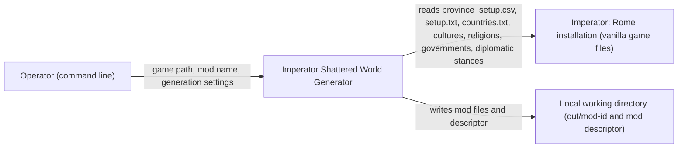
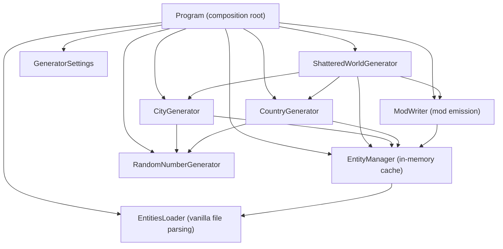
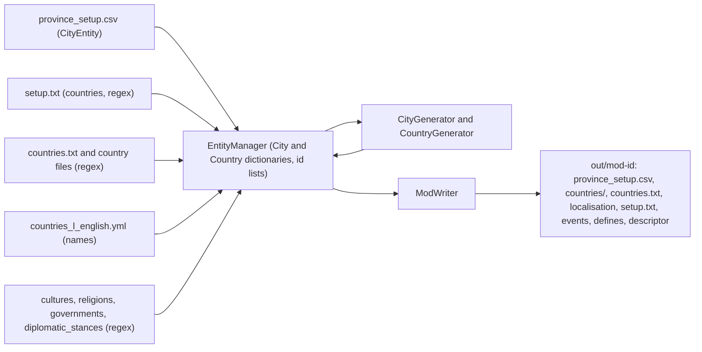
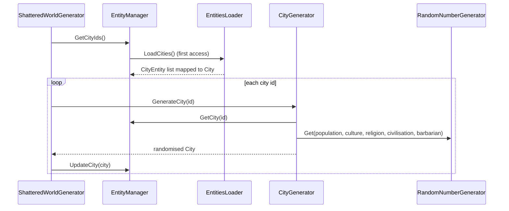
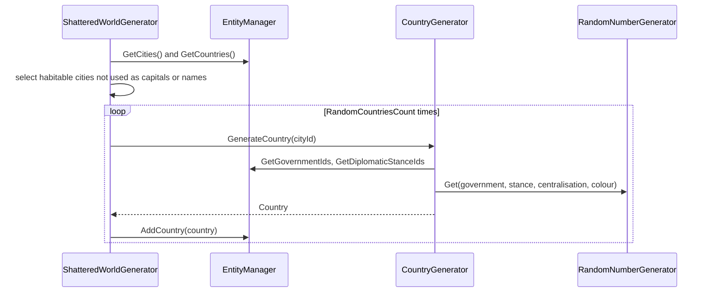
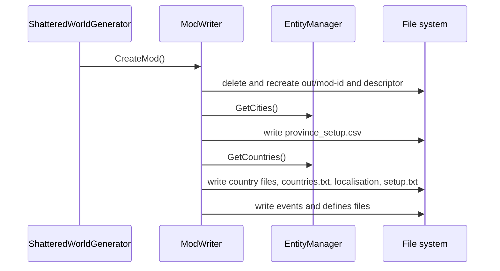
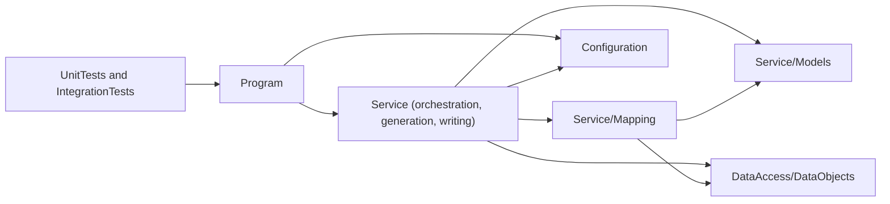

# Imperator Shattered World Generator Architecture

This document describes the current architecture of the Imperator Shattered World Generator, a .NET console application that rewrites the vanilla Imperator: Rome map into a shattered world mod. It covers the implemented system only, not a target or proposed design, and is scoped to the production project and its two test projects.

## 📑 Table of Contents

- [Purpose](#purpose)
- [System Context](#system-context)
- [Architectural Style](#architectural-style)
- [Runtime Process](#runtime-process)
- [Components](#components)
- [Architectural Areas](#architectural-areas)
  - [Configuration Namespace](#configuration-namespace)
  - [Data Access](#data-access)
  - [Service](#service)
  - [Tests](#tests)
- [Data Architecture](#data-architecture)
- [Interfaces and Integrations](#interfaces-and-integrations)
- [Key Processes](#key-processes)
  - [City Randomisation](#city-randomisation)
  - [Country Generation](#country-generation)
  - [Mod Emission](#mod-emission)
- [Shattered World Generation](#shattered-world-generation)
- [Cross-Cutting Concerns](#cross-cutting-concerns)
  - [Error Handling](#error-handling)
  - [Observability](#observability)
  - [Configuration](#configuration)
  - [Concurrency and Resource Use](#concurrency-and-resource-use)
- [Dependency Direction and Rules](#dependency-direction-and-rules)
- [External Dependencies](#external-dependencies)
- [Deployment and Operations](#deployment-and-operations)
- [Compatibility Contracts](#compatibility-contracts)
- [Testing and Verification](#testing-and-verification)
- [Design Constraints](#design-constraints)
- [Extension Points](#extension-points)
  - [Generation Service](#generation-service)
  - [Entity Loader](#entity-loader)
  - [Random Number Generator](#random-number-generator)
- [Source Map](#source-map)
- [Related Documentation](#related-documentation)

## 🎯 Purpose

The system's principal responsibility is to read the vanilla Imperator: Rome game files from a local installation, randomise the habitable cities, restrict the vanilla countries to their capitals, generate additional countries from vacant cities, and write the result as a self-contained mod. The architectural scope covers the command-line entry point, the composition root, the loading, generation, and writing services, and the persisted mod output. The intended audience is contributors who need to locate ownership, follow a generation run, and evaluate the impact of a change. Recording these boundaries is valuable because the game-facing output is compatibility-sensitive and the loading logic depends on the vanilla file formats.

## 🌐 System Context

The system operates entirely on the operator's machine. It reads the vanilla game files from a user-supplied installation directory, holds the working set in memory, and writes a mod directory and descriptor to the current working directory. There are no hosted services, network calls, telemetry, or remote stores. The material confidence boundary is the vanilla file formats, which are parsed with regular expressions and CSV repositories and are not validated against a schema.



The principal external boundaries are:
- **Operator:** Supplies the game path and mod name as mandatory arguments and the remaining generation settings optionally; owns the working directory and the installation.
- **Imperator: Rome installation:** Read-only source of vanilla game data; never modified by the application.
- **Local working directory:** Owned by the operator; receives the generated `out/<mod-id>/` directory and the `<mod-id>.mod` descriptor.

## 🏗️ Architectural Style

The system is a console batch pipeline built around dependency injection and a service-oriented structure. `Program.Main` parses arguments, builds a `Microsoft.Extensions.DependencyInjection` service collection, and resolves `IShatteredWorldGenerator`, which orchestrates the pipeline. Each collaborator is hidden behind an interface so that it can be substituted in tests. Loading is separated from generation and from persistence: `EntitiesLoader` reads and parses vanilla files, `EntityManager` caches the in-memory entities, the generators mutate domain models, and `ModWriter` serialises them back to game files. The principal consequence is that each stage has a single owner and can be replaced or tested in isolation, while the orchestration order remains fixed inside `ShatteredWorldGenerator`.



The principal architecture boundaries are:
- **Composition root:** `Program` owns argument parsing, service registration, and process lifecycle.
- **Orchestration:** `ShatteredWorldGenerator` owns the generation order and calls the generators and the writer.
- **Entity access:** `EntityManager` owns the in-memory caches and is the only component that triggers loading.
- **File parsing:** `EntitiesLoader` owns reading and parsing the vanilla game files.
- **Generation:** `CityGenerator` and `CountryGenerator` own the randomisation rules for cities and countries.
- **Persistence:** `ModWriter` owns the mod directory structure and file serialisation.
- **Configuration:** `GeneratorSettings` owns the settings values and the derived mod identifier and paths.

## 🔄 Runtime Process

```mermaid
flowchart TD
    start(["Program.Main"])
    parse["Parse and normalise command-line arguments"]
    settings["Build GeneratorSettings from arguments and defaults"]
    container["Build the service collection and resolve IShatteredWorldGenerator"]
    cities["GenerateCities: load cities, randomise each, update the manager"]
    countries["GenerateCountries: pick vacant cities and create countries"]
    capitals["GenerateCapitals: regenerate each country capital"]
    write["ModWriter.CreateMod: prepare directories and write mod files"]
    end(["Process exits"])

    start --> parse --> settings --> container --> cities --> countries --> capitals --> write --> end
```

The principal runtime sequence is:
1. `Program.Main` normalises short option aliases and parses the arguments into a `GeneratorSettings` instance.
2. The service collection is built with the settings singleton and the transient and singleton services, and `IShatteredWorldGenerator` is resolved.
3. `Generate` runs `GenerateCities`, `GenerateCountries`, and `GenerateCapitals` in that order, followed by `modWriter.CreateMod()`.
4. The process writes the mod to the working directory and exits.

## 🧩 Components

| Component | Responsibility | Principal Dependencies | Lifetime or Ownership |
|-----------|----------------|------------------------|-----------------------|
| `Program` | Argument parsing, service registration, and process lifecycle | `NuciCLI.Arguments`, `Microsoft.Extensions.DependencyInjection`, `GeneratorSettings` | Process entry point |
| `ShatteredWorldGenerator` | Orchestrates city, country, and capital generation and invokes the writer | `IEntityManager`, `ICityGenerator`, `ICountryGenerator`, `IModWriter`, `IRandomNumberGenerator`, `GeneratorSettings` | Singleton |
| `EntityManager` | Caches and exposes in-memory cities, countries, and identifier sets | `IEntityLoader` | Singleton; lazy caches |
| `EntitiesLoader` | Reads and parses vanilla game files into domain models | `NuciDAL.Repositories`, `GeneratorSettings`, `CityMapping` | Singleton |
| `CityGenerator` | Randomises city population, culture, religion, civilisation, and barbarian levels | `IEntityManager`, `IRandomNumberGenerator`, `GeneratorSettings` | Singleton |
| `CountryGenerator` | Generates country identity, culture, religion, government, stance, and colour | `IEntityManager`, `IRandomNumberGenerator`, `GeneratorSettings` | Singleton |
| `ModWriter` | Creates the mod directory structure and writes every mod file | `IEntityManager`, `GeneratorSettings` | Singleton |
| `RandomNumberGenerator` | Wraps a seeded `System.Random` and exposes inclusive range generation | `GeneratorSettings` | Transient |
| `GeneratorSettings` | Holds settings, defaults, and derived mod identifier and paths | `Environment.CurrentDirectory` | Singleton |

## 🗂️ Architectural Areas

### Configuration Namespace

Paths:
- `ImperatorShatteredWorldGenerator/Configuration`

Responsibilities:
- Hold the settings values, their defaults, and the derived mod identifier and file paths.

Boundary rules:
- Must not depend on the service, data access, or mapping namespaces.
- `ModId`, `ModDirectoryPath`, and `ModFilePath` are derived properties and must not be set directly.

### Data Access

Paths:
- `ImperatorShatteredWorldGenerator/DataAccess/DataObjects`

Responsibilities:
- Define the CSV-backed data objects used to read and write game entities.

Boundary rules:
- Must not depend on the service namespaces.
- Data objects are serialisation shapes only; behaviour belongs to the service models.

### Service

Paths:
- `ImperatorShatteredWorldGenerator/Service`
- `ImperatorShatteredWorldGenerator/Service/Mapping`
- `ImperatorShatteredWorldGenerator/Service/Models`

Responsibilities:
- Own orchestration, entity management, loading, generation, mapping, and mod writing.
- Define the domain models and the mappings between data objects and models.

Boundary rules:
- The service namespace may depend on configuration, data access, and mapping.
- Components collaborate through the `I`-prefixed interfaces rather than concrete types.
- Mapping extensions are the only place that translates between `CityEntity` and `City`.

### Tests

Paths:
- `ImperatorShatteredWorldGenerator.UnitTests`
- `ImperatorShatteredWorldGenerator.IntegrationTests`

Responsibilities:
- Verify the configuration, models, and services in isolation with unit tests.
- Verify the file-system loaders and the mod writer against a temporary game directory with integration tests.

Boundary rules:
- Test projects depend on the production project only.
- Integration tests exercise real file-system I/O; unit tests use Moq and deterministic random stubs.

## 💾 Data Architecture

The system owns no persistent database. It reads vanilla entities into memory, transforms them, and serialises them back to game-format files. `EntityManager` lazily populates its caches on first access and keeps them for the process lifetime; `UpdateCity` and `AddCountry` mutate the caches in place. `ModWriter` deletes and recreates the output directory and descriptor on every run, so the output is regenerated rather than incrementally updated.



| Data or Store | Owner | Representation and Storage | Lifecycle or Consistency |
|---------------|-------|----------------------------|--------------------------|
| `City` / `CityEntity` | `EntityManager` | Domain model in memory, CSV data object on disk | Loaded lazily on first access; mutated by `CityGenerator`; serialised by `ModWriter` |
| `Country` | `EntityManager` | Domain model in memory | Loaded from vanilla files, new entries added by `CountryGenerator`, all serialised by `ModWriter` |
| Identifier sets (culture, religion, government, diplomatic stance) | `EntityManager` | In-memory `IEnumerable<string>` lists | Loaded lazily once and cached for the process lifetime |
| `GeneratorSettings` | `Program` | In-memory settings object | Created once at startup; immutable during a run |

## 🔌 Interfaces and Integrations

| Interface or Integration | Direction | Contract | Owner | Failure Semantics |
|--------------------------|-----------|----------|-------|-------------------|
| `IEntityLoader` | Inbound | Loads cities, countries, and identifier sets from the game directory | `EntitiesLoader` | Unhandled I/O or parse exceptions terminate the process |
| `IEntityManager` | Inbound | Exposes and mutates in-memory entities and identifier sets | `EntityManager` | Returns `null` for unknown city or country identifiers |
| `ICityGenerator` | Inbound | Produces randomised cities and capitals | `CityGenerator` | No defined fallback; relies on present entity data |
| `ICountryGenerator` | Inbound | Produces a country from a capital city | `CountryGenerator` | Falls back to a random three-character identifier when a name-based identifier fails |
| `IModWriter` | Outbound | Writes the mod directory and files | `ModWriter` | Unhandled I/O exceptions terminate the process |
| `IRandomNumberGenerator` | Inbound | Seeded randomiser and inclusive range generation | `RandomNumberGenerator` | Deterministic for a fixed seed |
| Command-line arguments | Inbound | `-d`/`--dir`, `-n`/`--name`, `-s`/`--seed`, and generation settings | `Program` and `NuciCLI.Arguments` | Missing mandatory arguments abort before generation |
| Vanilla game files | Inbound | CSV and text files under the supplied game directory | `EntitiesLoader` | Assumed present and well-formed |

## 🔀 Key Processes

### City Randomisation



`GenerateCities` iterates every city identifier, randomises population composition, culture, religion, civilisation level, and barbarian level, and writes the result back into the manager. Population is distributed across slaves, tribesmen, freemen, and citizens by drawing a random class per population point. Ordering across cities follows the identifier order produced by `EntityManager`.

### Country Generation



Country generation is skipped entirely when `RandomCountriesCount` is zero, which keeps only the vanilla countries. Otherwise the orchestrator selects a pool of vacant, habitable cities, de-duplicated by name identifier, and creates one country per draw. Each country reuses its capital's culture and religion and receives a random government, diplomatic stance, centralisation level, and colour. The generator derives a three-letter identifier from the capital name where possible and otherwise falls back to a random identifier, rejecting reserved and already-used identifiers.

### Mod Emission



`CreateMod` prepares the directory structure, writes the mod descriptor to both the mod directory and the `<mod-id>.mod` path, and then writes each game file in a fixed order. Files that carry the game's non-ASCII identifiers are written as UTF-8; the remainder are written as plain text, and every file receives a leading and trailing newline normalisation.

## ⚙️ Shattered World Generation

The domain mechanics are the randomisation rules themselves. Cities always receive a randomised population, culture, religion, and civilisation level, and a barbarian level drawn within the configured range. Capitals are regenerated after countries are known so that their culture and religion match their country and their population uses the dedicated capital population setting. Vanilla countries are preserved, restricted to their capital, and marked with a comment in the generated setup file because removing them breaks vanilla events after enough in-game years pass. A single seeded `System.Random` instance is shared across all generators through `IRandomNumberGenerator`, so a fixed seed reproduces an entire run exactly.

## 🧵 Cross-Cutting Concerns

### Error Handling

Failures originate in file-system access during loading and writing and in parsing during loading. There is no explicit error-handling layer: I/O and parse exceptions are unhandled and terminate the process before any mod is written. `EntityManager` returns `null` for unknown identifiers, and `CountryGenerator` provides a documented fallback for identifier generation. There is no retry, fallback, or partial-write recovery.

### Observability

The only emitted signal is console text. `Program.Main` writes the seed in use before generation and a completion message afterwards. There are no logs, metrics, traces, health checks, or audit events, and no correlation context beyond the process stdout. This is the material diagnostic gap for operators investigating a failed run.

### Configuration

| Configuration Area | Source | Responsibility | Supersede or Secret Policy |
|--------------------|--------|----------------|---------------------------|
| Game directory path | Command line (`-d`, `--dir`, `--game`, `--imperator`) | Selects the vanilla installation to read | Mandatory; no default; no secret |
| Mod name | Command line (`-n`, `--name`) | Derives the mod identifier, directory, and descriptor name | Mandatory; no default |
| Random seed | Command line (`-s`, `--seed`) | Seeds the shared randomiser | Defaults to a random value |
| Generation ranges | Command line (`--capital-population`, `--city-*`, `--country-*`, `--random-countries`) | Bound the randomised values | Defaults defined in `GeneratorSettings` |

### Concurrency and Resource Use

The application is single-threaded. `System.Random` is shared across generators and is not thread-safe, which is safe only because generation runs sequentially. All entities are held in memory for the process lifetime, so peak memory scales with the number of cities and countries. The only external resource is the file system: the game directory is read and the output directory is written. There is no backpressure, pool, or capacity limit beyond the practical limit imposed by the game's ability to load the resulting mod.

## 🧭 Dependency Direction and Rules

Dependencies point inward from the composition root toward the domain services, and the service layer depends on configuration and data access rather than the reverse. Collaborators are reached through the `I`-prefixed interfaces, which protect the stable boundaries and enable substitution in tests.



The principal dependency rules are:
- `Program` may depend on every namespace; it is the only composition root.
- The service namespace must depend on other layers only through interfaces and models.
- `Configuration` and `DataAccess` must not depend on the service namespace.
- Mapping is the only translator between data objects and service models.
- Test projects depend on the production project and must not be referenced by it.

## 📦 External Dependencies

| Dependency | Responsibility | Integration Boundary | Architectural Consequence |
|------------|----------------|----------------------|---------------------------|
| `Microsoft.Extensions.DependencyInjection` | Constructs and resolves services | `Program` composition root | Registrations are centralised in `Program`; adding a service means editing the composition root |
| `NuciCLI.Arguments` | Parses command-line arguments | `Program` argument loading | Option names and aliases are declared in `Program` |
| `NuciDAL` | Provides CSV repository and data object abstractions | `EntitiesLoader`, `ModWriter`, `CityEntity` | City persistence is expressed as a CSV repository over `CityEntity` |
| `NuciExtensions` | Provides string and collection extensions | Services and mapping | Random element selection, punctuation and diacritic removal, and repetition are reused across services |

## 🚀 Deployment and Operations

The system ships as a self-contained console application published per platform (the repository provides `linux-x64`, `osx-x64`, and `win-x64` archives via `package.sh`). Operators extract an archive and run the executable with the game path and mod name; the generated mod is written to the working directory. There is no service topology, no persistent server state, and no scaling model.

| Concern | Current Design | Architectural Consequence |
|---------|----------------|---------------------------|
| Process topology | A single short-lived console process | Runs to completion and exits; no daemon or background worker |
| Deployment unit | A self-contained per-platform archive produced by `package.sh` | The operator must use the archive matching their platform |
| Persistent state | The generated `out/<mod-id>/` directory and `<mod-id>.mod` descriptor | The output is deleted and regenerated on every run; the operator owns backups |
| Recovery | None beyond re-running the generator | A failed run leaves no partial mod because output is prepared and written in one pass |
| Resource use | In-memory entity set and local file I/O | Memory scales with the game data size; no external service dependency |

## 🛡️ Compatibility Contracts

| Contract | Owner | Invariant | Verification | Change Policy |
|----------|-------|-----------|--------------|---------------|
| Mod directory and descriptor naming | `GeneratorSettings` | `ModId` is the lower-case, punctuation-free, diacritic-free, hyphenated mod name; the directory is `out/<ModId>` and the descriptor is `<ModId>.mod` | `GeneratorSettingsTests` | Changing the derivation breaks output placement and must be treated as breaking |
| Vanilla country preservation | `ShatteredWorldGenerator` and `ModWriter` | All vanilla countries remain in the generated setup with their capitals | `ShatteredWorldGeneratorTests` and `ModWriterTests` | Removal is prohibited because vanilla events depend on the countries |
| Reserved country identifiers | `CountryGenerator` | `REB`, `PIR`, `BAR`, and `MER` are never generated | `CountryGeneratorTests` | Adding reserved identifiers requires a matching writer change |
| CSV column order | `ModWriter` | `province_setup.csv` uses the documented column order | `ModWriterTests` | The game expects this order; changes must match the game format |
| Seeded determinism | `RandomNumberGenerator` | A fixed seed reproduces a run exactly | `RandomNumberGeneratorTests` | Any new random source must draw from the shared randomiser to preserve determinism |

## ✅ Testing and Verification

The solution contains two test projects. `ImperatorShatteredWorldGenerator.UnitTests` covers `GeneratorSettings`, `RandomNumberGenerator`, `EntityManager`, `CityGenerator`, `CountryGenerator`, and `ShatteredWorldGenerator` in isolation using Moq and deterministic random stubs. `ImperatorShatteredWorldGenerator.IntegrationTests` exercises `EntitiesLoader` and `ModWriter` against a temporary game directory and working directory. The tests use NUnit with Moq. Coverage is excluded from the test projects, and the two integration-test helpers (`TemporaryDirectory` and `WorkingDirectoryScope`) own the file-system isolation. There is no coverage threshold and no architecture test project.

Execute the principal automated verification with:

```bash
dotnet test --no-build
```

## ⚠️ Design Constraints

- **Vanilla country preservation:** Every vanilla country is retained regardless of settings, because removing them causes vanilla events to fail; this is not configurable.
- **Country count ceiling:** Generating very many countries can produce a mod that the game fails to load, and more than approximately 1,900 countries could not be generated without the game crashing at startup.
- **Regex-based loading:** Vanilla files are parsed with regular expressions and CSV repositories without schema validation, so a changed vanilla format can mis-parse silently.
- **Non-atomic output:** The output directory and descriptor are deleted and regenerated on every run, so previous output for the same mod is overwritten rather than versioned.
- **Single-threaded randomiser:** The shared `System.Random` is not thread-safe, so generation must remain sequential for determinism and correctness.
- **Working-directory dependence:** `GeneratorSettings` derives paths from `Environment.CurrentDirectory`, so the process must be run from the directory where the output is expected.

## 🔧 Extension Points

### Generation Service

1. Implement or revise the `IShatteredWorldGenerator` contract.
2. Register the implementation in the `Program` service collection.
3. Add the verification required to preserve the runtime sequence and the compatibility contracts.

The implementation must preserve the generation order (cities, then countries, then capitals, then mod writing) because capitals depend on the countries created earlier.

### Entity Loader

1. Implement or revise the `IEntityLoader` contract.
2. Register the implementation in the `Program` service collection and depend on it through `IEntityManager`.
3. Add the verification required to preserve the loaded entity shapes.

The loader must return domain models rather than data objects and must keep parsing concerns inside the loader and its mapping.

### Random Number Generator

1. Implement or revise the `IRandomNumberGenerator` contract.
2. Register the implementation in the `Program` service collection.
3. Add the verification required to preserve seeded determinism.

Any implementation must remain deterministic for a fixed seed and must expose an inclusive range generator consistent with `Get`.

## 🗺️ Source Map

| Area | Path |
|------|------|
| Composition root | `ImperatorShatteredWorldGenerator/Program.cs` |
| Configuration | `ImperatorShatteredWorldGenerator/Configuration` |
| Data access | `ImperatorShatteredWorldGenerator/DataAccess/DataObjects` |
| Services | `ImperatorShatteredWorldGenerator/Service` |
| Mapping | `ImperatorShatteredWorldGenerator/Service/Mapping` |
| Models | `ImperatorShatteredWorldGenerator/Service/Models` |
| Unit tests | `ImperatorShatteredWorldGenerator.UnitTests` |
| Integration tests | `ImperatorShatteredWorldGenerator.IntegrationTests` |
| Packaging | `package.sh` |
| Continuous integration | `.github/workflows/dotnet.yml` |

## 📚 Related Documentation

- [README.md](./README.md) defines the project's capabilities, usage, configuration, installation, and development workflow.
- [PRIVACY.md](./PRIVACY.md) defines the application's personal-data handling, which is limited to local file access.
- [LICENSE](./LICENSE) defines the licensing terms under which the project is distributed.