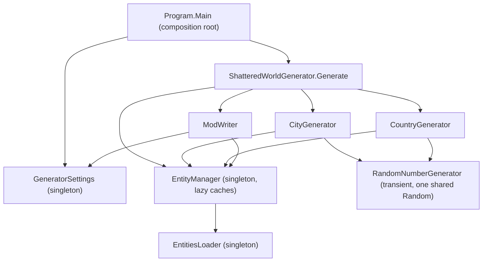

# Architecture

This document elaborates on the root [ARCHITECTURE.md](../ARCHITECTURE.md). It does not restate the system context, the component table, or the compatibility contracts; it explains how the pieces interact, why the stages are ordered as they are, and which consequences follow from the chosen structure.

## Architectural Shape

The application is a single-process, single-threaded batch pipeline with an explicit composition root:

The orchestration object holds the sequence; the services hold the rules. No service calls another service's generator, so the only place where stage order is expressed is `ShatteredWorldGenerator.Generate`.

## Layer Responsibilities

| Layer | Namespaces | Owns | Deliberately does not own |
|-------|-----------|------|---------------------------|
| Composition | `ImperatorShatteredWorldGenerator` (`Program`) | Argument parsing, service registration, process lifetime, console output | Generation rules, file formats |
| Configuration | `...Configuration` | Settings values, defaults, derived identifier and paths | Reading or writing game data |
| Data access | `...DataAccess.DataObjects` | CSV row shape (`CityEntity`) | Behaviour, validation, mapping |
| Services | `...Service` | Loading, caching, generation, orchestration, serialisation | Process-level concerns, argument syntax |
| Mapping | `...Service.Mapping` | Translation between data objects and domain models | Generation decisions |
| Models | `...Service.Models` | In-memory domain state and derived predicates | Persistence formats |
| Tests | `...UnitTests`, `...IntegrationTests` | Behavioural verification and file-system isolation | Production behaviour |

## Pipeline Ordering

Each stage depends on the state produced by the previous one:
- Countries are generated from *city* state, because a new country inherits its capital city's identifier, name, culture, and religion. Cities must already be randomised before countries are drawn, otherwise new countries would inherit vanilla culture and religion.
- Capitals are regenerated *after* countries exist, because regenerating a capital applies the owning country's culture, religion, and the dedicated capital population. A vanilla country's capital must therefore be rewritten with that country's values, not with the values the city stage happened to draw.
- Writing runs last because it reads the fully mutated entity set; `ModWriter` performs no generation of its own.

The ordering is asserted by `ShatteredWorldGeneratorTests.GivenAWorldGeneration_WhenGenerating_ThenCitiesCountriesCapitalsAndTheModAreProducedInOrder`.

## Lazy Loading and Cache Ownership

`EntityManager` is the only component that triggers `IEntityLoader`. Every read member follows the same shape: if the cache is null, load once, materialise it into a dictionary or list, then serve from the cache for the remaining process lifetime. Consequences:
- Loading cost is paid on first use, not at startup.
- `GetCityIds`, `GetCities`, and `GetCity` share one cache, so the identifier order is the order in which the CSV repository yields rows.
- Mutation members (`UpdateCity`, `AddCountry`) assume the cache exists. Calling them before any read throws `NullReferenceException`, which the unit tests document deliberately.
- Identifier lists (cultures, religions, governments, diplomatic stances) are cached as `List<string>` so repeated reads return the same instance.

See [Entity manager](./components/entity-manager.md) for details.

## Determinism Model

A single `System.Random` instance, seeded from `GeneratorSettings.Seed`, is exposed through `IRandomNumberGenerator.Randomiser` and is shared by both generators. Every random decision — population size, pop class, culture, religion, levels, government, stance, centralisation, colour, and random country identifiers — draws from that one stream. Therefore a fixed seed reproduces a complete run, provided that:
- the vanilla input files are identical,
- the collection ordering from `EntityManager` is identical,
- platform `System.Random` behaviour is identical (the .NET implementation is not contractually stable across major versions).

`Get(min, max)` is inclusive at both ends and short-circuits when `min == max`.

## Failure Topology

There is no error-handling layer. Failures propagate to `Program.Main` and terminate the process with a non-zero exit code and a stack trace on stderr:
- Missing or malformed vanilla files fail inside `EntitiesLoader`.
- Missing required arguments fail inside `Program` before any work begins.
- A request for more countries than there are vacant cities fails inside `ShatteredWorldGenerator.GenerateCountries` when the candidate list empties.
- File-system failures during writing fail inside `ModWriter` after the previous output was already deleted, leaving no mod.

See [Error handling](./error-handling.md).

## Extension Seams

| Seam | Interface | Constraint when replacing |
|------|-----------|---------------------------|
| Pipeline | `IShatteredWorldGenerator` | Must preserve city → country → capital → write order |
| File parsing | `IEntityLoader` | Must return domain models, never data objects |
| Entity access | `IEntityManager` | Must keep caches coherent for both generators and the writer |
| City rules | `ICityGenerator` | Capital generation must apply the country's culture and religion |
| Country rules | `ICountryGenerator` | Must not allocate `REB`, `PIR`, `BAR`, `MER`, or an existing identifier |
| Output | `IModWriter` | Must keep file paths, column order, and BOM behaviour |
| Randomness | `IRandomNumberGenerator` | Must remain seeded and reproduce inclusive ranges |

Registration happens only in `Program.Main`; see [Composition root](./components/composition-root.md).