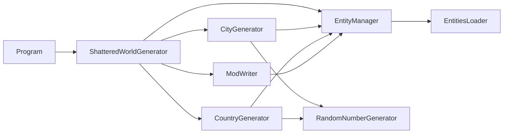

# Components Index

Each component page records purpose, location, entry, execution, data, state, dependencies, dependants, configuration, failures, invariants, tests, integration, and modification impact.

| Component | Page | One-line purpose |
|-----------|------|------------------|
| `Program` | [Composition Root](./composition-root.md) | Parse arguments, register services, run the generator |
| `GeneratorSettings` | [Generator Settings](./generator-settings.md) | Hold settings, defaults, derived identifier and paths |
| `EntitiesLoader` | [Entities Loader](./entities-loader.md) | Parse vanilla game files into domain models |
| `EntityManager` | [Entity Manager](./entity-manager.md) | Cache and mutate in-memory entities lazily |
| `CityGenerator` | [City Generator](./city-generator.md) | Randomise a city's population, culture, religion, and levels |
| `CountryGenerator` | [Country Generator](./country-generator.md) | Create a country from a capital city and allocate its identifier |
| `RandomNumberGenerator` | [Random Number Generator](./random-number-generator.md) | Expose one seeded `Random` and inclusive ranges |
| `ModWriter` | [Mod Writer](./mod-writer.md) | Prepare the mod directory and serialise every file |
| `ShatteredWorldGenerator` | [Orchestration](./orchestration.md) | Sequence cities, countries, capitals, and writing |
| `City`, `Country`, `CityEntity`, `CityMapping` | [Domain Models and Mapping](./domain-models-and-mapping.md) | Domain state and data-object translation |

## Component interaction summary

Read [Architecture](../architecture.md) first for the surrounding model, and [Flows](../flows/README.md) for the runtime sequences.