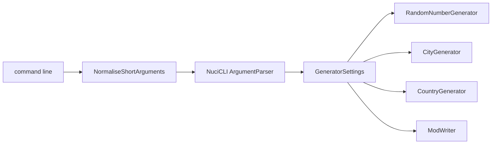

# Configuration

## Sources and precedence

Configuration has exactly one source: the process command line. There are no configuration files, environment variables, or user settings. Each option is read once in `Program.LoadSettings`, written into a `GeneratorSettings` instance, and then treated as immutable for the rest of the run. Later aliases of the same option resolve in the order the alias array declares, because `GetArgumentValue` returns the first non-blank match.

Two options are mandatory. Everything else falls back to the value already present on `GeneratorSettings`, which is populated in its constructor.

## Options

| Setting | Aliases | Default | Applied to |
|---------|---------|---------|------------|
| Game directory | `-d`, `--dir`, `--game`, `--imperator` | Mandatory | `GeneratorSettings.GameDirectoryPath` |
| Mod name | `-n`, `--name` | Mandatory | `GeneratorSettings.ModName` |
| Seed | `-s`, `--seed` | `new Random().Next()` | `GeneratorSettings.Seed` |
| Capital population | `--capital-population`, `--capital-pops` | `10` | `GeneratorSettings.CapitalPopulation` |
| City population minimum | `--city-population-min`, `--city-pops-min` | `4` | `GeneratorSettings.CityPopulationMin` |
| City population maximum | `--city-population-max`, `--city-pops-max` | `12` | `GeneratorSettings.CityPopulationMax` |
| City civilisation minimum | `--city-civilisation-min`, `--city-civ-min` | `0` | `GeneratorSettings.CityCivilisationLevelMin` |
| City civilisation maximum | `--city-civilisation-max`, `--city-civ-max` | `20` | `GeneratorSettings.CityCivilisationLevelMax` |
| City barbarian minimum | `--city-barbarian-min`, `--city-barb-min` | `0` | `GeneratorSettings.CityBarbarianLevelMin` |
| City barbarian maximum | `--city-barbarian-max`, `--city-barb-max` | `0` | `GeneratorSettings.CityBarbarianLevelMax` |
| Country centralisation minimum | `--country-centralisation-min`, `--country-cent-min` | `0` | `GeneratorSettings.CountryCentralisationLevelMin` |
| Country centralisation maximum | `--country-centralisation-max`, `--country-cent-max` | `100` | `GeneratorSettings.CountryCentralisationLevelMax` |
| Generated country count | `--random-countries`, `--new-countries`, `--rng-countries` | `500` | `GeneratorSettings.RandomCountriesCount` |

## Syntax

### Accepted forms

Both forms are accepted and are normalised before parsing:

```bash
# separate value
--dir /path/to/ImperatorRome --name "Shattered World" --seed 613

# inline value
--dir=/path/to/ImperatorRome --name="Shattered World" --seed=613

# short alias (separate value or inline value)
-d /path/to/ImperatorRome -n "Shattered World" -s 613
```

`Program.NormaliseShortArguments` splits each token on the first `=` and translates a short alias to its long form using `ShortOptionAliases` (`-d` → `--dir`, `-n` → `--name`, `-s` → `--seed`). The value is then re-appended as a separate token, so the parser always sees `--name value`.

### Short aliases

Only three aliases exist: `-d`, `-n`, `-s`. Every other option must be written in its long form.

## Validation

Validation is minimal and fails by exception:

| Condition | Behaviour |
|-----------|-----------|
| A mandatory option is absent or blank | `Program.GetRequiredArgumentValue` throws `ArgumentException("Missing required argument: --dir")` (or `--name`) before the container is built |
| An integer option is present but not parseable | `int.Parse` throws `FormatException` |
| `min > max` for any range | Not validated; `rng.Get` returns `max` only when `min == max`, otherwise `System.Random.Next(min, max + 1)` throws `ArgumentOutOfRangeException` |
| `RandomCountriesCount < 0` | Not validated; the loop body never executes, so no countries are generated |
| `RandomCountriesCount` exceeds the vacant-city pool | `InvalidOperationException` from the random selection when the pool empties |
| Unknown option | Ignored; `NuciCLI.Arguments` tolerates unregistered names |

## Derived values

`GeneratorSettings` derives three values rather than storing them:

| Derived value | Formula |
|---------------|---------|
| `ModId` | `ModName` with punctuation removed, diacritics removed, spaces replaced by `-`, and lower-cased |
| `ModDirectoryPath` | `Path.Combine(Environment.CurrentDirectory, "out", ModId)` |
| `ModFilePath` | `ModDirectoryPath + ".mod"` |

Because spaces are replaced after punctuation removal and no collapsing is performed, two consecutive spaces produce two consecutive hyphens (`"Shattered  World"` → `"shattered--world"`), which `GeneratorSettingsTests` records as intended behaviour.

## Settings that are accepted but unused

`CityCivilisationLevelMin` is parsed from the command line, stored on the settings object, defaulted to `0`, and asserted by `GeneratorSettingsTests` — but `CityGenerator.GenerateCity` never reads it:

```csharp
city.CivilizationLevel = rng.Get(settings.CityBarbarianLevelMin, settings.CityCivilisationLevelMax);
city.BarbarianLevel    = rng.Get(settings.CityBarbarianLevelMin, settings.CityBarbarianLevelMax);
```

The civilisation draw therefore uses the *barbarian* minimum as its lower bound. See [Ambiguities and Open Questions](./ambiguities-and-open-questions.md#civilisation-minimum-is-ignored).

## Configuration surface



Every consumer receives the same singleton instance, so no component can observe a settings value different from any other.