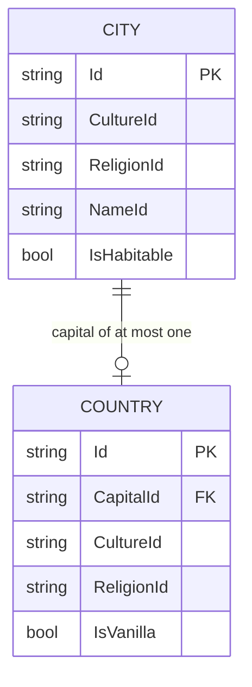

# Data Model

## Domain models

### `City`

Declared in `ImperatorShatteredWorldGenerator/Service/Models/City.cs` as a `sealed class` of mutable auto-properties.

| Member | Type | Mutability | Meaning |
|--------|------|------------|---------|
| `Id` | `string` | Set | Province identifier; also the dictionary key in `EntityManager` |
| `CultureId` | `string` | Set | Vanilla culture identifier; overwritten by `CityGenerator` |
| `ReligionId` | `string` | Set | Vanilla religion identifier; overwritten by `CityGenerator` |
| `TradeGoodId` | `string` | Set | Trade good; never modified by the application |
| `CitizensCount` | `int` | Set | Citizens component of the population |
| `FreemenCount` | `int` | Set | Freemen component |
| `TribesmenCount` | `int` | Set | Tribesmen component |
| `SlavesCount` | `int` | Set | Slaves component |
| `CivilizationLevel` | `int` | Set | Civilisation level |
| `BarbarianLevel` | `int` | Set | Barbarian level |
| `NameId` | `string` | Set | Name reference used for localisation and for country naming |
| `ProvinceId` | `string` | Set | Province reference written to the `AraRef` column |
| `TotalPopulation` | `int` | Derived | Sum of the four population components |
| `IsHabitable` | `bool` | Derived | True only when `CultureId`, `ReligionId`, `TradeGoodId`, `NameId`, and `ProvinceId` are all non-whitespace |

Two derived members carry real behaviour:
- `TotalPopulation` is the only way the generator detects an unchanged population (see [City generator](./components/city-generator.md)).
- `IsHabitable` is the filter that decides which cities may become new countries. It is deliberately string-based: a missing attribute, not a zero population, makes a city uninhabitable. `CityTests` verifies `null`, `""`, `" "`, and `"\t\r\n"` all report `false`.

### `Country`

Declared in `ImperatorShatteredWorldGenerator/Service/Models/Country.cs`.

| Member | Type | Default | Meaning |
|--------|------|---------|---------|
| `Id` | `string` | `null` | Three-letter country tag |
| `Name` | `string` | `null` | Display name; taken from localisation for vanilla countries and from the capital's `NameId` for generated ones |
| `ColourRed`, `ColourGreen`, `ColourBlue` | `int` | `0` | Map colour components |
| `CultureId` | `string` | `null` | Primary culture |
| `ReligionId` | `string` | `null` | State religion |
| `GovernmentId` | `string` | `null` | Government identifier |
| `DiplomaticStanceId` | `string` | `null` | Diplomatic stance; omitted from `setup.txt` when blank |
| `CapitalId` | `string` | `null` | Capital city identifier |
| `CentralisationLevel` | `int` | `-1` | Sentinel meaning *unset*; never written when negative |
| `ShipNames` | `IEnumerable<string>` | Six fixed names | Written verbatim into each country file |
| `IsVanilla` | `bool` | `false` | Distinguishes preserved vanilla countries from generated ones |

Constructor-set defaults:
- `ShipNames` is a fresh `List<string>` of `Boaty`, `McBoatface`, `Boatface`, `Shippy`, `McShipface`, `Shipface`. Each `Country` receives its own list, which `CountryTests` verifies.
- `CentralisationLevel = -1` lets `ModWriter` omit the line for vanilla countries whose setup file had no value (see the loader's behaviour of never setting it).

## Data object

### `CityEntity`

Declared in `ImperatorShatteredWorldGenerator/DataAccess/DataObjects/CityEntity.cs`, deriving from `NuciDAL.DataObjects.EntityBase`. It is a serialisation shape only: `CivilizationLevel` and `BarbarianLevel` are `string` here and `int` in `City`, because the CSV repository maps columns positionally to strings.

Property order defines the CSV column order consumed by `CsvRepository<CityEntity>`:

```text
Id, CultureId, ReligionId, TradeGoodId, CitizensCount, FreemenCount, TribesmenCount, SlavesCount, CivilizationLevel, BarbarianLevel, NameId, ProvinceId
```

## Mapping

`ImperatorShatteredWorldGenerator/Service/Mapping/CityMapping.cs` is an internal static class with extension methods:

| Method | Direction | Conversion |
|--------|-----------|------------|
| `ToServiceModel(this CityEntity)` | data object → domain | `int.Parse` on `CivilizationLevel` and `BarbarianLevel` |
| `ToDataObject(this City)` | domain → data object | `ToString()` on the two level fields |
| `ToServiceModels(this IEnumerable<CityEntity>)` | collection → collection | Lazy `Select` projection |

Note that `CityMapping.ToServiceModel` assigns `TribesmenCount` twice and `ToDataObject` does the same; the duplicate assignment is harmless because the same value is written both times, but it is a wart to leave alone unless intentionally cleaning up. See [Ambiguities and Open Questions](./ambiguities-and-open-questions.md).

## Vanilla-to-mod field mapping

### `province_setup.csv`

| Written column | Source |
|----------------|--------|
| `ProvID` | `City.Id` |
| `Culture` | `City.CultureId` |
| `Religion` | `City.ReligionId` |
| `TradeGoods` | `City.TradeGoodId` |
| `Citizens` | `City.CitizensCount` |
| `Freedmen` | `City.FreemenCount` |
| `Slaves` | `City.SlavesCount` |
| `Tribesmen` | `City.TribesmenCount` |
| `Civilization` | `City.CivilizationLevel` |
| `Barbarian` | `City.BarbarianLevel` |
| `NameRef` | `City.NameId` |
| `AraRef` | `City.ProvinceId` |

The header written by `ModWriter.WriteProvincesSetup` orders the population columns `Citizens;Freedmen;Slaves;Tribesmen`, while the data rows are written `Citizens,Freemen,Tribesmen,Slaves`. The data-row order matches `CityEntity`'s property order, which is what the reader relies on; the header order therefore disagrees with the values. See [Ambiguities and Open Questions](./ambiguities-and-open-questions.md).

### Country files and definitions

| Output | Source |
|--------|--------|
| `out/<mod-id>/common/countries/<Id>.txt` | `colour = rgb { r g b }` from the three colour components plus a `ship_names` block from `ShipNames` |
| `out/<mod-id>/common/countries.txt` | Four fixed entries (`REB`, `PIR`, `BAR`, `MER`) plus one line per country |
| `out/<mod-id>/localization/SW_countries_l_english.yml` | One ` Id:0 "Name"` line per non-vanilla country |
| `out/<mod-id>/common/setup.txt` | One block per country with government, optional stance, culture, religion, optional centralisation, capital, and `own_control_core` |

## Relationship model



The invariant enforced by `ShatteredWorldGenerator.GenerateCountries` is one-directional: no city that is already a country capital, and no city whose `NameId` equals an existing country name, may be chosen as a new country's capital.