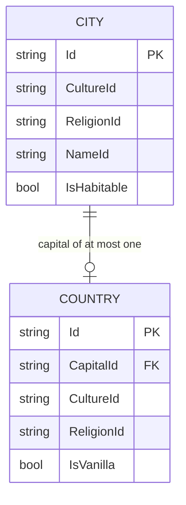

# Data Model

## Domain models

### `City`

Declared in `ImperatorShatteredWorldGenerator/Service/Models/City.cs` as a `sealed class` of mutable auto-properties.

| Member | Type | Mutability | Meaning |
|--------|------|------------|---------|
| `Id` | `string` | Set | Province identifier; also the dictionary key in `EntityManager` |
| `CultureId` | `string` | Set | Vanilla culture identifier; overwritten by `CityGenerator` |
| `ReligionId` | `string` | Set | Vanilla religion identifier; overwritten by `CityGenerator` |
| `TradeGoodId` | `string` | Set | Trade good; never modified by the application |
| `CitizensCount` | `int` | Set | Citizens component of the population |
| `FreemenCount` | `int` | Set | Freemen component |
| `TribesmenCount` | `int` | Set | Tribesmen component |
| `SlavesCount` | `int` | Set | Slaves component |
| `CivilizationLevel` | `int` | Set | Civilisation level |
| `BarbarianLevel` | `int` | Set | Barbarian level |
| `NameId` | `string` | Set | Name reference used for localisation and for country naming |
| `ProvinceId` | `string` | Set | The province identifier the city was loaded from |
| `ProvinceRank` | `string` | Set | Vanilla province rank (`settlement`, `city`, `city_metropolis`) |
| `PreservedLines` | `IEnumerable<string>` | Set | Vanilla block lines the mod does not manage and re-emits verbatim |
| `TotalPopulation` | `int` | Derived | Sum of the four population components |
| `IsHabitable` | `bool` | Derived | True only when `CultureId`, `ReligionId`, `TradeGoodId`, `NameId`, and `ProvinceId` are all non-whitespace |

Two derived members carry real behaviour:
- `TotalPopulation` is the only way the generator detects an unchanged population (see [City generator](./components/city-generator.md)).
- `IsHabitable` is the filter that decides which cities may become new countries. It is deliberately string-based: a missing attribute, not a zero population, makes a city uninhabitable. `CityTests` verifies `null`, `""`, `" "`, and `"\t\r\n"` all report `false`.

### `Country`

Declared in `ImperatorShatteredWorldGenerator/Service/Models/Country.cs`.

| Member | Type | Default | Meaning |
|--------|------|---------|---------|
| `Id` | `string` | `null` | Three-letter country tag |
| `Name` | `string` | `null` | Display name; taken from localisation for vanilla countries and from the capital's `NameId` for generated ones |
| `ColourRed`, `ColourGreen`, `ColourBlue` | `int` | `0` | Map colour components |
| `CultureId` | `string` | `null` | Primary culture |
| `ReligionId` | `string` | `null` | State religion |
| `GovernmentId` | `string` | `null` | Government identifier |
| `DiplomaticStanceId` | `string` | `null` | Diplomatic stance; omitted from `setup.txt` when blank |
| `CapitalId` | `string` | `null` | Capital city identifier |
| `CentralisationLevel` | `int` | `-1` | Sentinel meaning *unset*; never written when negative |
| `DefinitionFilePath` | `string` | `null` | Vanilla file path referenced by the country index |
| `PreservedLines` | `IEnumerable<string>` | `null` | Vanilla setup lines the mod does not manage and re-emits verbatim |
| `ShipNames` | `IEnumerable<string>` | Six fixed names | Written verbatim into each country file |
| `IsVanilla` | `bool` | `false` | Distinguishes preserved vanilla countries from generated ones |

Constructor-set defaults:
- `ShipNames` is a fresh `List<string>` of `Boaty`, `McBoatface`, `Boatface`, `Shippy`, `McShipface`, `Shipface`. Each `Country` receives its own list, which `CountryTests` verifies.
- `CentralisationLevel = -1` lets `ModWriter` omit the line for vanilla countries whose setup file had no value (see the loader's behaviour of never setting it).

## Data object

### `CityEntity`

Declared in `ImperatorShatteredWorldGenerator/DataAccess/DataObjects/CityEntity.cs`, deriving from `NuciDAL.DataObjects.EntityBase`. It is a serialisation shape only: `CivilizationLevel` and `BarbarianLevel` are `string` here and `int` in `City`, so that fractional vanilla values survive the parse.

### `ProvinceDefinitionEntity`

Declared in `ImperatorShatteredWorldGenerator/DataAccess/DataObjects/ProvinceDefinitionEntity.cs`, deriving from `EntityBase` and annotated with `CsvColumn` attributes. It maps the semicolon-separated `map_data/definition.csv`: `EntityBase.Id` is column 1, and `Red`, `Green`, `Blue`, and `Name` are columns 2–5.

## Mapping

`ImperatorShatteredWorldGenerator/Service/Mapping/CityMapping.cs` is an internal static class with extension methods:

| Method | Direction | Conversion |
|--------|-----------|------------|
| `ToServiceModel(this CityEntity)` | data object → domain | Lenient parse of `CivilizationLevel` and `BarbarianLevel`, truncating fractional values |
| `ToDataObject(this City)` | domain → data object | `ToString()` on the two level fields |
| `ToServiceModels(this IEnumerable<CityEntity>)` | collection → collection | `Select` projection |

## Vanilla-to-mod field mapping

### `setup/provinces`

Each habitable city is written as a province block in `out/<mod-id>/setup/provinces/02_shattered_world.txt`:

| Written attribute | Source |
|-------------------|--------|
| province id key | `City.Id` |
| `barbarian_power` | `City.BarbarianLevel` |
| `civilization_value` | `City.CivilizationLevel` |
| `culture` | `City.CultureId` |
| `province_rank` | `City.ProvinceRank` |
| `religion` | `City.ReligionId` |
| `trade_goods` | `City.TradeGoodId` |
| preserved lines | `City.PreservedLines` |
| `citizen` / `freemen` / `slaves` / `tribesmen` blocks | the four population counters, each emitted only when positive |

### Country files and definitions

| Output | Source |
|--------|--------|
| `out/<mod-id>/setup/countries/<Id>.txt` | `color = rgb { r g b }` from the three colour components plus a `ship_names` block from `ShipNames`, for generated countries only |
| `out/<mod-id>/setup/countries/countries.txt` | Four fixed entries (`REB`, `PIR`, `BAR`, `MER`) plus one line per country (vanilla countries keep their original relative path) |
| `out/<mod-id>/localization/english/SW_countries_l_english.yml` | One ` Id:0 "Name"` line per non-vanilla country |
| `out/<mod-id>/setup/main/02_shattered_world_countries.txt` | One block per country with government, optional stance, culture, religion, optional centralisation, capital, preserved lines, and `own_control_core` |

## Relationship model

The invariant enforced by `ShatteredWorldGenerator.GenerateCountries` is one-directional: no city that is already a country capital, and no city whose `NameId` equals an existing country name, may be chosen as a new country's capital.