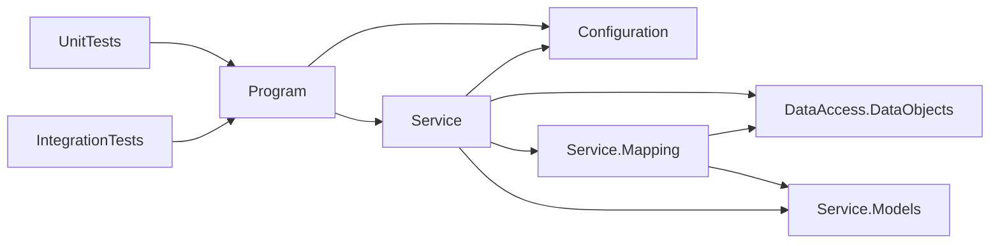

# Dependencies

## Runtime packages (production project)

| Package | Version | Used by | Purpose |
|---------|---------|---------|---------|
| `Microsoft.Extensions.DependencyInjection` | 11.0.0 | `Program` | Builds and resolves the service graph |
| `NuciCLI.Arguments` | 1.0.3 | `Program` | `ArgumentParser`, `ArgumentsCollection` |
| `NuciDAL` | 4.3.1 | `EntitiesLoader`, `ModWriter`, `CityEntity` | `CsvRepository<T>`, `IFileRepository<T>`, `EntityBase` |
| `NuciExtensions` | 6.0.3 | `GeneratorSettings`, `CountryGenerator`, `CityGenerator`, `ShatteredWorldGenerator`, `ModWriter` | `RemovePunctuation`, `RemoveDiacritics`, `GetRandomElement`, `All`, `Repeat` |

## Test packages (both test projects)

| Package | Version | Purpose |
|---------|---------|---------|
| `Microsoft.NET.Test.Sdk` | 18.12.0 | Test host |
| `Moq` | 4.21.0 | Interface doubles |
| `NUnit` | 5.0.0 | Test framework and assertions |
| `NUnit3TestAdapter` | 6.3.1 | VSTest adapter |

Both test projects share the same package set and `ProjectReference` the production project. Neither references the other.

## Framework and language

| Attribute | Value |
|-----------|-------|
| Target framework | `net10.0` |
| Language version | `latest` |
| Nullable reference types | `enable` (tests); production project does not opt in explicitly, so the SDK default applies |
| Implicit usings | `disable` (tests); production uses explicit `using` directives throughout |
| Solution format | `.slnx` |

## External, non-packaged dependencies

| Dependency | Consumed by | Nature |
|------------|-------------|--------|
| Imperator: Rome installation | `EntitiesLoader` | Read-only input: `game/setup/provinces/**`, `game/setup/main/**`, `game/setup/countries/**`, `game/map_data/definition.csv`, `game/common/cultures/**`, `game/common/governments/**`, `game/common/diplomatic_stances/**`, `game/common/religions/00_default.txt`, `game/localization/english/countries_l_english.yml` |
| File system (working directory) | `GeneratorSettings`, `ModWriter` | Output: `out/<mod-id>/`, `out/<mod-id>.mod` |
| `zip` utility | `package.sh` | Release packaging |
| .NET SDK 10 | `package.sh`, CI | Build and self-contained publish |

## Internal dependency direction

Notes:
- `Configuration` and `DataAccess` never reference `Service`. `EntitiesLoader` (in `Service`) references `DataAccess` and `Mapping`.
- `CityMapping` is the only type that references both `DataAccess.DataObjects` and `Service.Models`.
- `IEntityLoader` lives in `Service` but its implementations return models in `Service.Models`, keeping the data-object type out of the service interface.

## Version constraints to respect when updating

- `NuciDAL` provides the CSV repository whose column mapping is positional; a major upgrade can change ordering semantics and must be validated against `EntitiesLoaderTests` and `ModWriterTests`.
- `NuciExtensions` supplies `GetRandomElement(IEnumerable<T>, Random)`, which is used as the sole selection helper; changing its semantics (for example using `Random.Next` vs `NextDouble`) would change every generated world.
- `NuciCLI.Arguments` decides whether unregistered options are tolerated; `Program` relies on `ParseArgs` accepting all registered names.

For the update procedure, follow the `update-nuget-packages` skill: baseline tests first, then per-project updates, then validation.