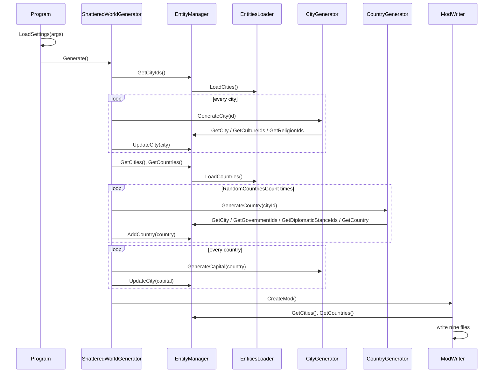

# Flows Index

| Flow | Page | Covers |
|------|------|--------|
| Startup and generation | [Startup and Generation](./startup-and-generation.md) | Argument parsing through a completed mod |
| City randomisation | [City Randomisation](./city-randomisation-flow.md) | The city stage, cache warm-up, and per-city draws |
| Country generation | [Country Generation](./country-generation-flow.md) | Pool construction, draws, registration, and failures |
| Capital regeneration | [Capital Regeneration](./capital-regeneration-flow.md) | Why capitals are rewritten after countries exist |
| Mod emission | [Mod Emission](./mod-emission-flow.md) | Directory preparation and each file write |

Each flow names the exact methods involved so that a debugger can set breakpoints without searching.

## Combined sequence

See also [Orchestration](../components/orchestration.md) for the invariants each stage preserves.