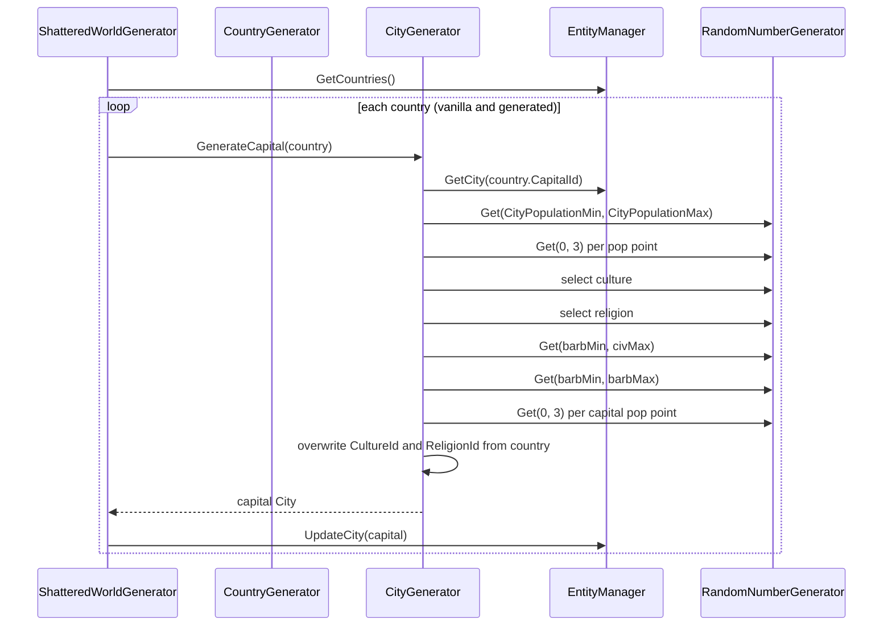

# Capital Regeneration Flow

## Why it exists

The city stage randomises every city, including the capitals of vanilla countries. That leaves each vanilla capital with a culture and religion unrelated to the country it belongs to. Regenerating capitals after the country stage fixes that:
- A vanilla country keeps its vanilla culture and religion, so its capital is aligned to them.
- A generated country copied its culture and religion from the capital, so the second pass is a no-op for those two fields but still applies the dedicated capital population.

## Sequence

## Draw cost

Each capital consumes a full `GenerateCity` budget *plus* a second population draw at `CapitalPopulation` size. The full randomisation is not needed for the capital's final state, because population is replaced and culture and religion are overwritten, but the draws still occur and therefore advance the stream.

The visible result is the capital population and the aligned culture and religion; the intermediate civilisation and barbarian levels from the first `GenerateCity` call survive, because the second population call does not touch them.

## Population replacement

`SetCityPopulation(city, CapitalPopulation)` returns early when the city already has exactly that population. Otherwise it zeroes all four counts and redistributes. Consequently a capital whose random population happened to equal `CapitalPopulation` keeps the original class distribution instead of a fresh one. `CityGeneratorTests` asserts the replacement path (previous 128 citizens and 64 slaves are discarded) and the ordinary path.

## Ordering dependency

Capitals must be regenerated after `AddCountry`, otherwise generated countries' capitals would not exist. The stage order is enforced by `Generate` and asserted by the ordering test, which records `cities`, `countries`, `capitals`, `mod`.

## Failure surface

| Condition | Result |
|-----------|--------|
| A country whose `CapitalId` is unknown | `GetCity` returns `null` → `NullReferenceException` |
| `CapitalPopulation` negative | All four counts remain zero |

## Verification

- `GivenACapital_WhenGeneratingTheCapital_ThenTheCountryCultureAndReligionAreApplied`
- `GivenACapital_WhenGeneratingTheCapital_ThenTheConfiguredCapitalPopulationIsUsed`
- `GivenAnExistingPopulation_WhenGeneratingTheCapital_ThenThePreviousPopulationsAreDiscarded`
- `GivenCountries_WhenGeneratingCapitals_ThenEveryCapitalIsRegeneratedAndStored`