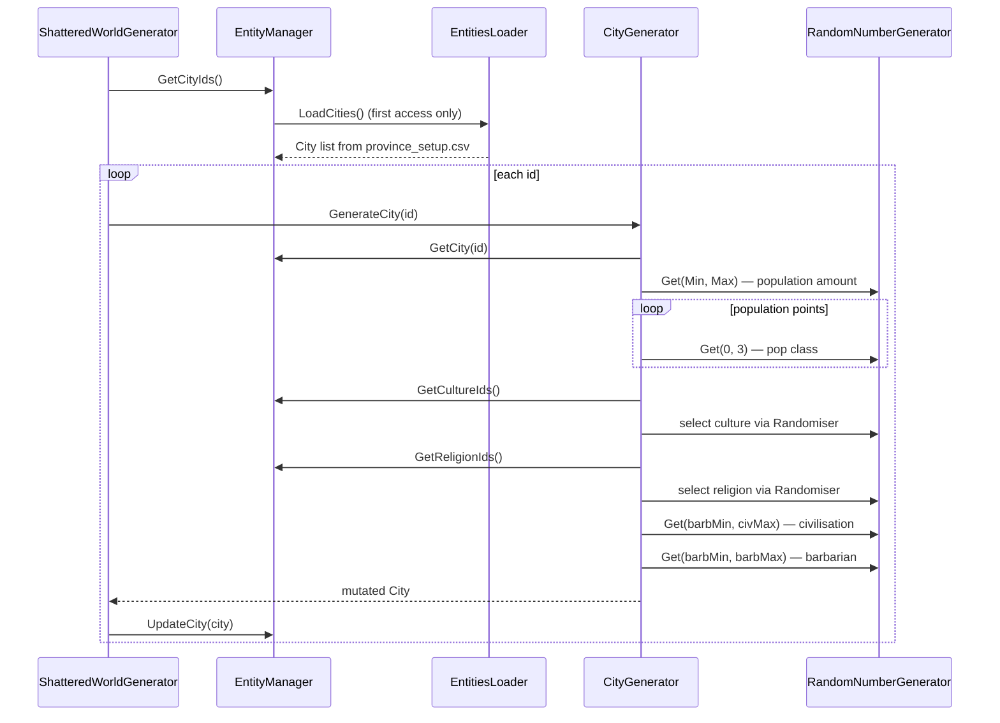

# City Randomisation Flow

## Participants

`ShatteredWorldGenerator` → `CityGenerator` → `EntityManager` → `EntitiesLoader`; `CityGenerator` → `IRandomNumberGenerator`.

## Sequence

## Draw order per city

The order matters because it defines the stream:
1. One draw for the total population.
2. One draw per population point for the class.
3. One selection for culture (`Randomiser.Next`).
4. One selection for religion.
5. One draw for the civilisation level.
6. One draw for the barbarian level.

The amount draw is skipped when the drawn range is degenerate, but the caller still performs it.

## Population early return

`SetCityPopulation(city, amount)` returns without drawing classes when the city's current `TotalPopulation` already equals `amount`. This affects the stream: a city that happens to match its target consumes one fewer set of draws than a neighbour. It is the reason the same seed reproduces exactly only while the same vanilla data is used.

## Cache warm-up

The first city processed triggers three loads: cities (from `GetCityIds`), cultures, and religions. Because identifier collections are cached, subsequent cities pay no file cost. `EntityManagerTests` verifies each loader method is invoked exactly once regardless of how many reads occur.

## Failure surface

| Condition | Where |
|-----------|-------|
| Unknown identifier | `GetCity` returns `null` → `NullReferenceException` |
| Empty culture or religion list | `GetRandomElement` throws |
| `Min > Max` for population | `ArgumentOutOfRangeException` inside `Random.Next` |

## Verification

`CityGeneratorTests` scripts the stream with `StubRandom` and `SequenceRandom`, asserting the population distribution for sequence `0,1,2,3` (one slave, one tribesman, one freeman, one citizen) and the exact draw counts (`Times.Exactly(4)` for a population of four). `ShatteredWorldGeneratorTests` asserts one `GenerateCity` and one `UpdateCity` per identifier.