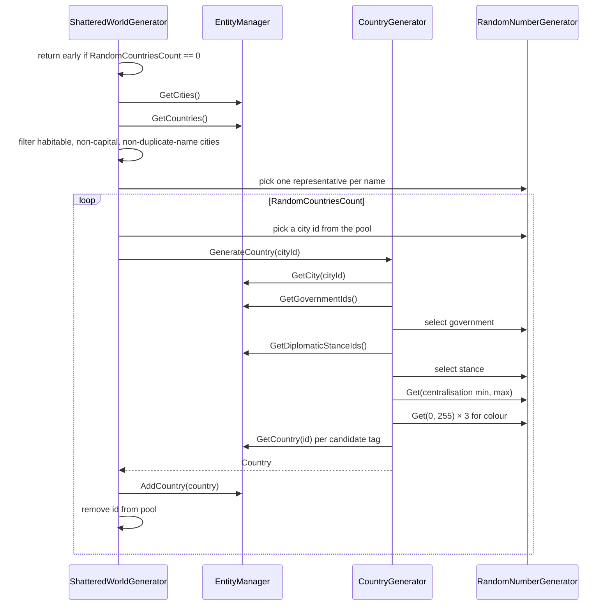

# Country Generation Flow

## Participant sequence

## Filter chain explained

The LINQ chain in `GenerateCountries` runs inside out:
1. `IsHabitable` — cheapest rejection, purely string checks.
2. Capital exclusion — `entityManager.GetCountries().All(country => country.CapitalId != city.Id)`. Because the country collection is read for every city, this is `O(cities × countries)` and re-enumerates the dictionary for each city. Correctness relies on no mutation during the chain; `AddCountry` is only called after the chain has produced a `List<string>`.
3. Name exclusion — `country.Name != city.NameId`. At this point `GetCountries()` contains only vanilla countries, because generated countries have not yet been added. New countries therefore cannot be excluded by name during pool construction; uniqueness among generated countries is instead guaranteed by removing the drawn identifier from the pool.
4. `GroupBy(x => x.NameId)` then `GetRandomElement` per group — collapses synonym cities to one representative each, using `rng.Randomiser` (the orchestrator's own stream).
5. `Select(x => x.Id)` materialises identifiers.

## Identifier allocation inside the generator

`GenerateCountry` derives the tag before touching the pool state, so the *first* draw for a given name succeeds deterministically and every later name resolves differently depending on which tags are already taken. `IsCapitalIdValid` consults `entityManager.GetCountry`, which sees every previously added country.

## Registration and pool removal

`AddCountry` mutates the dictionary; `validCityIds.Remove(cityId)` removes the identifier from the local pool. Both are required for termination:
- Removing from the pool guarantees at most one country per city.
- Adding to the manager makes later tag uniqueness checks accurate.

If the pool empties before the loop completes, `GetRandomElement` throws `InvalidOperationException`. Countries already added remain in memory, but the writer is never reached, so no partial mod exists on disk.

## Draw accounting

The orchestrator's stream is consumed by the per-group representative selection and by each capital selection. The generator's own stream is consumed by government, stance, centralisation, three colour draws, and possibly random-tag attempts plus `GetRandomElement` calls for government and stance.

Because these are separate `Random` instances, the count of pool selections does not shift government values.

## Verification

| Behaviour | Test |
|-----------|------|
| Exact configured count | `GivenRandomCountriesRequested_WhenGenerating_ThenTheConfiguredNumberOfCountriesIsCreated` |
| Zero means none | `GivenNoRandomCountriesRequested_WhenGenerating_ThenNoCountryIsGeneratedOrAdded` |
| Name de-duplication | `GivenCitiesSharingAName_WhenGeneratingCountries_ThenOnlyOneCountryIsCreatedForThatName` |
| Vanilla capital excluded | `GivenACityUsedAsAVanillaCapital_WhenGeneratingCountries_ThenItIsNotUsedAsANewCountry` |
| Vanilla name excluded | `GivenACityNamedAfterAVanillaCountry_WhenGeneratingCountries_ThenItIsNotUsedAsANewCountry` |
| Uninhabitable excluded | `GivenAnInhabitableCity_WhenGeneratingCountries_ThenItIsNotUsedAsANewCountry` |
| Empty pool | `GivenNoVacantCities_WhenGeneratingCountries_ThenTheGenerationFails` |
| Pool too small | `GivenMoreCountriesThanVacantCities_WhenGeneratingCountries_ThenTheGenerationFails` |