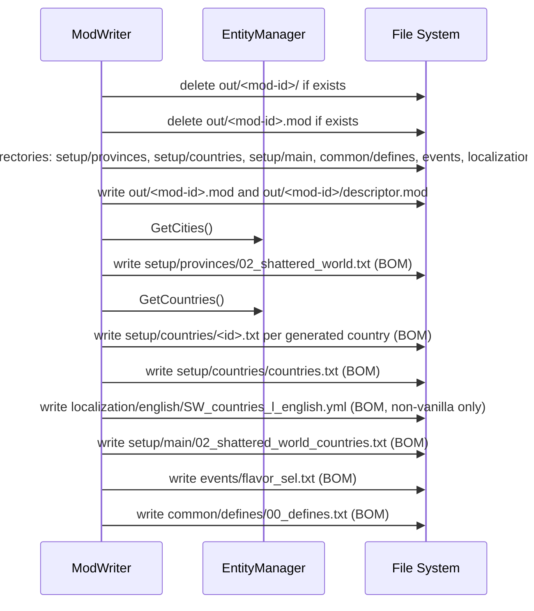

# Mod Emission Flow

## Trigger

The final step of `IShatteredWorldGenerator.Generate`: `modWriter.CreateMod()`.

## Step-by-step sequence



## Step details

### 1. `PrepareDirectoryStructure`

```text
Directory.Delete(settings.ModDirectoryPath, true) if exists
File.Delete(settings.ModFilePath) if exists
Directory.CreateDirectory(...) for setup/provinces, setup/countries, setup/main, common/defines, events, localization/english
```

The deletion is recursive and unprompted; `ModWriterTests` confirms that stale files inside the directory are removed and that the `.mod` file is discarded.

### 2. `WriteModDescriptor`

Emits:

```text
name = "<ModName>"
path = "mod/<ModId>"
```

written to both `out/<mod-id>.mod` (read by the game launcher) and `out/<mod-id>/descriptor.mod` (inside the mod folder). Both paths are normalised with newlines.

### 3. `WriteProvinces`

Writes `out/<mod-id>/setup/provinces/02_shattered_world.txt`. Each city produces a block:

```text
# <NameId>
<Id>=
{
	barbarian_power=<BarbarianLevel>
	civilization_value=<CivilizationLevel>
	culture="<CultureId>"
	province_rank="<ProvinceRank>"
	religion="<ReligionId>"
	trade_goods="<TradeGoodId>"
	<preserved lines>
	citizen=
	{
		amount=<CitizensCount>
	}
	...
}
```

Emitted with a UTF-8 BOM via `WriteUnicodeFile`. Only positive population blocks are written. The file name starts with `02_` so it merges with, rather than replaces, the vanilla `00_*` province files.

### 4. `WriteCountryFiles`

For each **generated** country, writes `out/<mod-id>/setup/countries/<Id>.txt` with RGB colour and ship names. Vanilla countries keep their original files, whose paths are reused in the index.

### 5. `WriteCountriesDefinitionIndexFile`

Writes `out/<mod-id>/setup/countries/countries.txt`:

```text
REB = "setup/countries/rebels.txt"
PIR = "setup/countries/pirates.txt"
BAR = "setup/countries/barbarians.txt"
MER = "setup/countries/mercenaries.txt"
<Tag> = "<original relative path>"   (vanilla countries)
<Tag> = "setup/countries/<Tag>.txt"  (generated countries)
```

### 6. `WriteCountriesLocalisationFile`

Writes `out/<mod-id>/localization/english/SW_countries_l_english.yml`:

```text
l_english:
 <Id>:0 "<Name>"
```

Only countries where `!country.IsVanilla` are written. For vanilla countries, the game's existing localisation is relied on.

### 7. `WriteCountrySetupFile`

Writes `out/<mod-id>/setup/main/02_shattered_world_countries.txt`. Each country produces a block:

```text
		<Id> = { # <Name>
			# VANILLA COUNTRY - REQUIRED FOR COMPATIBILITY
			# Removing it could break the game once enough ingame years (even decades) have passed
			government = <GovernmentId>
			diplomatic_stance=<DiplomaticStanceId>   # omitted if blank
			primary_culture = <CultureId>
			religion = <ReligionId>
			centralization=<CentralisationLevel>     # omitted if negative
			capital = <CapitalId>
			<preserved lines>
			own_control_core = { <CapitalId> }
		}
```

Vanilla countries include the two compatibility comment lines and their preserved setup lines; generated countries omit them.

### 8. `WriteEventsFile`

Writes `out/<mod-id>/events/flavor_sel.txt` containing the `grinsel.2` province event that grants five slave pops upon trigger.

### 9. `WriteDefinesFile`

Writes `out/<mod-id>/common/defines/00_defines.txt` setting `NGame.START_DATE = "450.10.1"`, matching the current game baseline.

## Encoding split

Two writer helpers govern encoding:

| Helper | Encoding | Used for |
|--------|----------|----------|
| `WriteFile` | UTF-8 without BOM (`File.WriteAllText`) | `.mod`, `descriptor.mod` |
| `WriteUnicodeFile` | UTF-8 **with** BOM (`new StreamWriter(path, false, Encoding.UTF8)`) | `setup/provinces`, country files, `countries.txt`, `setup/main`, `SW_countries_l_english.yml`, `flavor_sel.txt`, `00_defines.txt` |

The BOM is required by the game's text parsers for files containing non-ASCII identifiers; `ModWriterTests.GivenACreatingModRequest_WhenCreatingTheMod_ThenEveryUnicodeFileStartsWithAByteOrderMark` verifies byte-for-byte that the first three bytes are `0xEF 0xBB 0xBF`.

## Failure surface

| Failure | Stage | Result |
|---------|-------|--------|
| Output directory not writable | 1 | `UnauthorizedAccessException` before deletion |
| Incomplete entity set | 3 | A province file with only the header comment is written; asserted by `GivenNoCities_WhenCreatingTheMod_ThenTheProvinceFileContainsOnlyTheHeader` |
| Unset stance / centralisation | 7 | Omitted silently from the setup file (by design) |
| Disk fills during write | Any | Partial mod on disk; no rollback |

## Verification

`ImperatorShatteredWorldGenerator.IntegrationTests/Service/ModWriterTests.cs` asserts all 17 behaviours against a temporary directory wrapped by `WorkingDirectoryScope`.