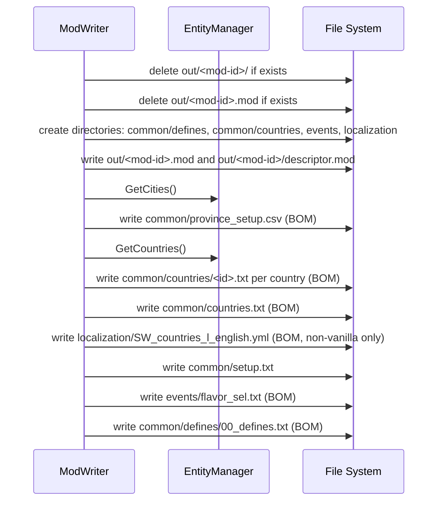

# Mod Emission Flow

## Trigger

The final step of `IShatteredWorldGenerator.Generate`: `modWriter.CreateMod()`.

## Step-by-step sequence



## Step details

### 1. `PrepareDirectoryStructure`

```text
Directory.Delete(settings.ModDirectoryPath, true) if exists
File.Delete(settings.ModFilePath) if exists
Directory.CreateDirectory(...) for defines, countries, events, localization
```

The deletion is recursive and unprompted; `ModWriterTests` confirms that stale files inside the directory are removed and that the `.mod` file is discarded.

### 2. `WriteModDescriptor`

Emits:

```text
name = "<ModName>"
path = "mod/<ModId>"
```

written to both `out/<mod-id>.mod` (read by the game launcher) and `out/<mod-id>/descriptor.mod` (inside the mod folder). Both paths are normalised with newlines.

### 3. `WriteProvincesSetup`

Writes the header `#ProvID;Culture;Religion;TradeGoods;Citizens;Freedmen;Slaves;Tribesmen;Civilization;Barbarian;NameRef;AraRef`, then a comma-separated row per city. The row values are:

```text
Id, CultureId, ReligionId, TradeGoodId, CitizensCount, FreemenCount, TribesmenCount, SlavesCount, CivilizationLevel, BarbarianLevel, NameId, ProvinceId
```

Emitted with a UTF-8 BOM via `WriteUnicodeFile`.

### 4. `WriteCountryFiles`

For each country in `entityManager.GetCountries()`: writes `out/<mod-id>/common/countries/<Id>.txt` with RGB colour and ship names. Every country gets a file, vanilla and generated alike.

### 5. `WriteCountriesDefinitionIndexFile`

Writes `out/<mod-id>/common/countries.txt`:

```text
REB = "countries/rebels.txt"
PIR = "countries/pirates.txt"
BAR = "countries/barbarians.txt"
MER = "countries/mercenaries.txt"
<Id> = "countries/<Id>.txt"   (one per country)
```

### 6. `WriteCountriesLocalisationFile`

Writes `out/<mod-id>/localization/SW_countries_l_english.yml`:

```text
l_english:
 <Id>:0 "<Name>"
```

Only countries where `!country.IsVanilla` are written. For vanilla countries, the game's existing localisation is relied on.

### 7. `WriteSetupFile`

Writes `out/<mod-id>/common/setup.txt`. Each country produces a block:

```text
    <Id> = { # <Name>
      # VANILLA COUNTRY - REQUIRED FOR COMPATIBILITY
      # Removing it could break the game once enough ingame years (even decades) have passed
      government = <GovernmentId>
      diplomatic_stance = <DiplomaticStanceId>      # omitted if blank
      primary_culture = <CultureId>
      religion = <ReligionId>
      centralization = <CentralisationLevel>        # omitted if negative
      capital = <CapitalId>
      own_control_core = { <CapitalId> }
    }
```

Vanilla countries include the two compatibility comment lines; generated countries omit them.

### 8. `WriteEventsFile`

Writes `out/<mod-id>/events/flavor_sel.txt` containing the `grinsel.2` province event that grants five slave pops upon trigger.

### 9. `WriteDefinesFile`

Writes `out/<mod-id>/common/defines/00_defines.txt` setting `NGame.START_DATE = "001.10.1"`.

## Encoding split

Two writer helpers govern encoding:

| Helper | Encoding | Used for |
|--------|----------|----------|
| `WriteFile` | UTF-8 without BOM (`File.WriteAllText`) | `.mod`, `descriptor.mod`, `setup.txt` |
| `WriteUnicodeFile` | UTF-8 **with** BOM (`new StreamWriter(path, false, Encoding.UTF8)`) | `province_setup.csv`, country files, `countries.txt`, `SW_countries_l_english.yml`, `flavor_sel.txt`, `00_defines.txt` |

The BOM is required by the game's text parsers for files containing non-ASCII identifiers; `ModWriterTests.GivenACreatingModRequest_WhenCreatingTheMod_ThenEveryUnicodeFileStartsWithAByteOrderMark` verifies byte-for-byte that the first three bytes are `0xEF 0xBB 0xBF`.

## Failure surface

| Failure | Stage | Result |
|---------|-------|--------|
| Output directory not writable | 1 | `UnauthorizedAccessException` before deletion |
| Incomplete entity set | 3 | An empty `province_setup.csv` (header only) is written; asserted by `GivenNoCities_WhenCreatingTheMod_ThenTheProvinceSetupContainsOnlyTheHeader` |
| Unset stance / centralisation | 7 | Omitted silently from `setup.txt` (by design) |
| Disk fills during write | Any | Partial mod on disk; no rollback |

## Verification

`ImperatorShatteredWorldGenerator.IntegrationTests/Service/ModWriterTests.cs` asserts all 17 behaviours against a temporary directory wrapped by `WorkingDirectoryScope`.