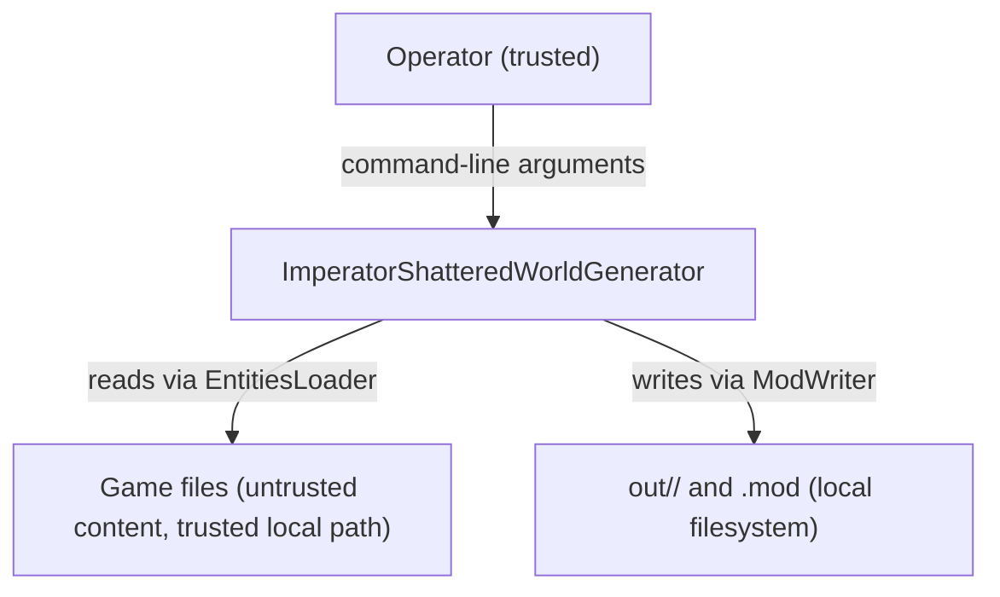

# Security

This document complements the root [SECURITY.md](../SECURITY.md) and [PRIVACY.md](../PRIVACY.md). It details the trust boundaries, defensive posture, and security-relevant invariants implemented in the codebase.

## Threat model

The application is an offline console tool. It has:
- no listening ports,
- no outbound network connections,
- no IPC,
- no shared-memory interfaces,
- no elevated privilege requirements,
- no personal data collection.

Its execution is entirely local to the operator's machine and bounded by the operator's user account.

## Trust boundaries

### 1. Command-line inputs
Supplied directly by the operator. Evaluated without shell expansion inside the runtime; arguments are tokenised by the hosting shell before `Program.Main` receives them.

### 2. Vanilla game files
Read from `--dir`. Assumed to be non-malicious vanilla files, but parsed defensively:
- City data is parsed through a structured CSV repository (`NuciDAL.Repositories.CsvRepository`).
- Other text files are parsed line-by-line using anchored regular expressions.
- No binary deserialisers, reflection-based formatters, or executable code loaders (`Assembly.Load`, etc.) are used.

### 3. Output directory
Written to `out/<mod-id>` relative to `Environment.CurrentDirectory`. Path traversal is prevented by `GeneratorSettings.ModId`:
- Spaces become hyphens.
- Punctuation is stripped via `NuciExtensions.RemovePunctuation()`.
- Diacritics are removed via `NuciExtensions.RemoveDiacritics()`.
- The result is converted to lower-case.
- Characters such as `..`, `/`, `\`, and `:` are stripped before path combination.

## Data handling and privacy

As described in [PRIVACY.md](../PRIVACY.md):
- Zero telemetry, metrics, or diagnostic data transmitted.
- Zero credentials, tokens, or personal identifiers handled.
- No files outside the target output mod directory are modified or deleted.
- Input files are opened read-only (`File.ReadAllLines`, `File.ReadAllText`, and `CsvRepository` in read mode).

## Cryptography and randomness

The application does **not** use cryptographic randomness. `System.Random` is used exclusively for procedural game mod generation (city attributes, country tags, colours, stances, etc.). It must not be repurposed for security-sensitive operations such as key generation, nonce creation, or token generation.

## Dependencies and supply chain

- Dependencies are pinned to specific versions in `ImperatorShatteredWorldGenerator.csproj`.
- Dependencies are restored exclusively via official NuGet feeds during CI (`.github/workflows/dotnet.yml`).
- Trimming and publication packaging are restricted to `package.sh` and explicit developer publication steps.

## Vulnerability reporting

To report security issues, refer to the reporting procedure in [SECURITY.md](../SECURITY.md).