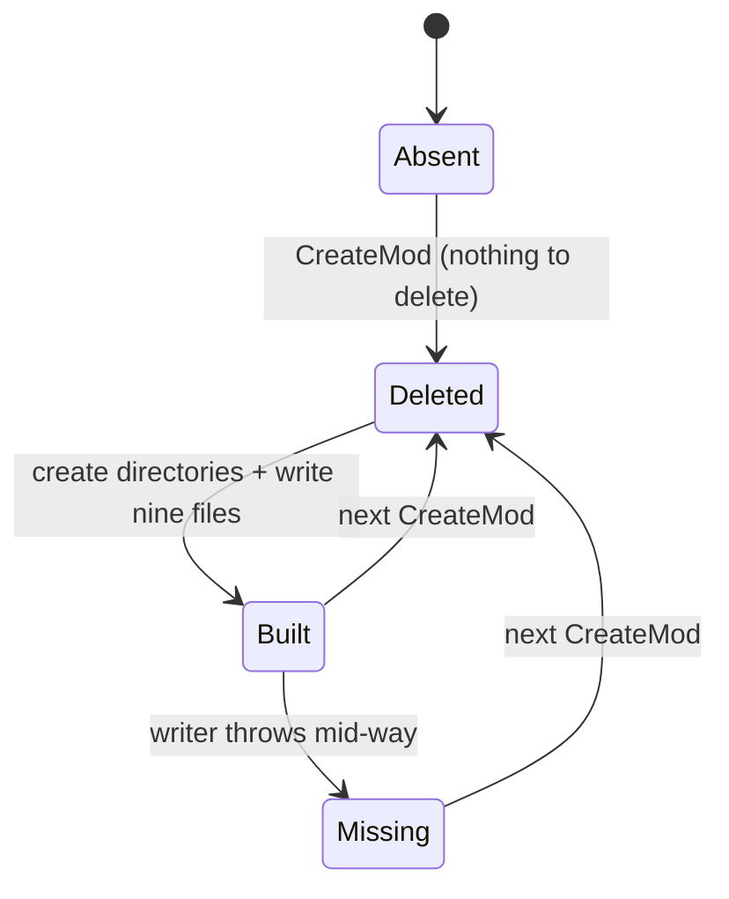

# State and Persistence

## State inventory

| State | Owner | Storage | Lifetime |
|-------|-------|---------|----------|
| Generation settings | `GeneratorSettings` (singleton) | Heap | Process |
| City dictionary | `EntityManager.cities` | Heap | Process, populated lazily |
| Country dictionary | `EntityManager.countries` | Heap | Process, populated lazily |
| Culture identifiers | `EntityManager.cultureIds` | Heap (`List<string>`) | Process |
| Religion identifiers | `EntityManager.religionIds` | Heap (`List<string>`) | Process |
| Government identifiers | `EntityManager.governmentIds` | Heap (`List<string>`) | Process |
| Diplomatic stance identifiers | `EntityManager.diplomaticStanceIds` | Heap (`List<string>`) | Process |
| Random streams | `RandomNumberGenerator` instances | Heap | Process |
| Mod output | File system | `out/<mod-id>/`, `out/<mod-id>.mod` | Until deleted or the next run |

## No database, no cache service

There is no database, no ORM, no external cache, no migration, and no schema. The only persistence is the generated mod. `NuciDAL.CsvRepository` is used purely as a CSV reader over `CityEntity` and as a writer handle inside `ModWriter`, not as a durable store.

## Cache population

Every cache is populated on first access. Loading is triggered only by `EntityManager`, which means:
- `GetCityIds` / `GetCities` / `GetCity` all warm the city cache.
- `GetCountries` / `GetCountry` warm the country cache.
- Each identifier getter warms its own list.

Nothing is invalidated or refreshed. In a batch process this is sufficient; a long-running host would observe stale data.

## Mutation points

| Mutation | Caller | Effect |
|----------|--------|--------|
| `UpdateCity(city)` | `ShatteredWorldGenerator.GenerateCities`, `GenerateCapitals` | Replaces the dictionary entry for `city.Id` |
| `AddCountry(country)` | `ShatteredWorldGenerator.GenerateCountries` | Adds a dictionary entry; throws on a duplicate key |

Both mutations assume the cache has been initialised by a prior read. This is guaranteed by the orchestration order but is not enforced by `EntityManager` itself. See [Entity Manager](./components/entity-manager.md).

## Output lifecycle

The writer always begins by deleting, so:
- Running twice for the same mod name discards the first result entirely.
- Running with a different mod name leaves the previous output untouched.
- A mid-write failure leaves a partially written mod that the next run discards.

`ModWriterTests.GivenAnExistingModDirectory_WhenCreatingTheMod_ThenThePreviousOutputIsDiscarded` verifies that a stale file inside the directory and a stale `.mod` file are both removed.

## Journals

The game itself may create a `save games` journal for a mod; the application does not read or write anything of the sort.

## Backup expectations

Because the writer deletes rather than versions, an operator who wants to keep a world must copy `out/<mod-id>/` elsewhere before the next run. There is no rotation, no timestamped suffix, and no retention policy.

## Migration

None. Existing mods are not upgraded; the output is regenerated from the vanilla source each time. Vanilla file-format changes affect loading, not an in-place migration.